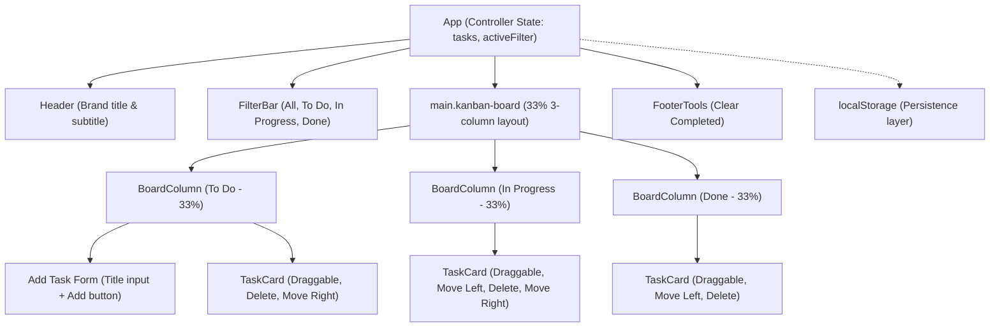

# Architecture

## Pattern
- **Component-Based**: UI/display logic is strictly separated from state management.
- **Controller View**: `App.tsx` acts as the controller, managing global state and handlers, passing them down to presentational components (`BoardColumn`, `TaskCard`).
- **Unidirectional Data Flow**: State flows down from App to Columns to Tasks. Events flow up via callbacks.

## Component Hierarchy
```
<App> (State: tasks, activeFilter)
  <Header/>
  <FilterBar/>             ← NEW: filter pill buttons
  <main.kanban-board>
    <BoardColumn id="todo">
      <AddForm/>
      <TaskCard/>*
    </BoardColumn>
    <BoardColumn id="inprogress">
      <TaskCard/>*
    </BoardColumn>
    <BoardColumn id="done">
      <TaskCard/>*
    </BoardColumn>
  </main>
```




## State Management

### Single Source of Truth
All tasks and filter state live in `App.tsx` as the root component. Child components receive data and callbacks via props — no child component holds its own copy of task state.

### Derivation
Columns are derived from the master task list using `useMemo`. This avoids redundant re-renders when unrelated state changes.

### Persistence
`useLocalStorageState` is a custom hook that wraps `useState` and automatically syncs state to `localStorage` on every write. This gives the app zero-setup persistence without a backend.

---

## State Management Trade-offs (Architecture Decision)

### Chosen Pattern: Prop Drilling / Lifted State

All state lives in `App.tsx` and is passed down to child components. This is sometimes called "lifting state up" — the simplest form of shared state management in React.

| Approach | Chosen? | Reason |
|---|---|---|
| **Lifted state (App.tsx)** | ✅ Yes | Minimal abstraction, zero dependencies, ideal for ≤3 levels of depth |
| **Context API** | ❌ No | Overkill for 2 levels of prop drilling; adds Provider boilerplate without benefit at this scale |
| **Zustand** | ❌ No | External dependency; unnecessary for a single-page board with one data entity |
| **Redux / Redux Toolkit** | ❌ No | Designed for complex async flows and large teams; adds significant boilerplate for a 3-column board |

### When Would We Migrate?

We would migrate to **Context API** if:
- Task objects gained more fields (description, assignee, due date) requiring state access deep in the tree
- Sub-components needed to trigger updates without prop drilling through 3+ levels

We would migrate to **Zustand or Redux** if:
- Multiple independent pages/views needed to share task state
- Async operations (API calls, optimistic updates) were added

### Summary
At the current scale, lifting state keeps the codebase flat, readable, and free of unnecessary abstractions. The total prop depth is 2 levels (App → Column → Card), which React handles efficiently with no performance concern.

---

## Drag and Drop

Implemented using the **native HTML5 Drag-and-Drop API** — no third-party libraries.

### How It Works
- `TaskCard` has the `draggable={true}` attribute, making it a drag source.
- On `dragstart`, the task's `id` is stored in `event.dataTransfer` as a string.
- `BoardColumn` listens for three native browser events (mapped via React's synthetic event system):
  - `onDragOver` → prevents the default "no-drop" cursor; marks the column as an active drop target
  - `onDragLeave` → clears the active drop zone visual highlight
  - `onDrop` → reads the task ID from `dataTransfer`, calls `handleMoveTask`

### Native Browser Events Used
These React event handlers map directly to native browser DOM events:

| React Prop | Native Browser Event |
|---|---|
| `draggable` | Sets `draggable` HTML attribute |
| `onDragStart` | `dragstart` |
| `onDragOver` | `dragover` (with `e.preventDefault()`) |
| `onDragLeave` | `dragleave` |
| `onDrop` | `drop` |

This is equivalent to attaching `addEventListener('dragover', ...)` directly on the DOM element. No library wraps or abstracts these events — they are the browser's own pointer/drag events.

### Why Not `mousedown`/`mousemove`?
The HTML5 DnD API (dragstart/dragover/drop) is the standardized browser mechanism for drag-and-drop. Implementing via raw `mousedown`/`mousemove`/`mouseup` would require manual hit-testing, scroll handling, and ghost image rendering — all of which the browser's native DnD API provides for free. The assignment's mention of `mousedown`/`mousemove` refers to the category of "native browser events" as opposed to library abstractions — the HTML5 DnD events fall squarely in that category.
